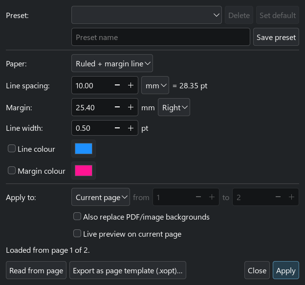

# Line Spacing — Xournal++ plugin

Change the **line spacing (line height)**, margin line, line width and colours of Xournal++'s ruled, lined, graph and dotted page backgrounds from a settings window. You can also **save the settings as presets** for future use and **start new documents** with them.

Xournal++ can already draw backgrounds with any spacing, but its own menus only offer the fixed 24 pt ruling. This plugin exposes the hidden per-page background settings (`r1`, `m1`, `lw`, `f1`, `f2`).



## Requirements

- Xournal++ **1.3.7 or newer**. The plugin relies on the `config` argument of `app.changeCurrentPageBackground`.
- For the settings window you need GTK bindings for Lua:
  - Fedora: `sudo dnf install lua-lgi`
  - Debian/Ubuntu: `sudo apt install lua-lgi`
  - Flathub Xournal++: already bundled (LuaGObject)

  Without them, the plugin falls back to a simpler dialog with buttons.

## Install

```sh
scripts/install.sh            # symlinks LineSpacing/ into ~/.config/xournalpp/plugins/
scripts/install.sh --copy     # copy instead of symlink
scripts/install.sh --uninstall
```

Restart Xournal++. If the plugin doesn't appear, enable it under *Plugin → Plugin Manager*.

## Use

Everything is in the **Plugin** menu:

| Menu entry | Shortcut | What it does |
|---|---|---|
| Line spacing: Configure… | Ctrl+Alt+S | Opens the settings window |
| Line spacing: Looser (+2 pt) | Ctrl+Alt+= | Increases the current page's spacing |
| Line spacing: Tighter (−2 pt) | Ctrl+Alt+− | Decreases the current page's spacing |
| Line spacing: Reset to default | | Sets spacing back to the format default (24 pt; 5 mm for graph/dotted) |
| Line spacing: Apply default preset | | Applies the preset marked ★ |
| Line spacing: New document (default preset) | | File → New, then gives page 1 the ★ preset |
| Line spacing preset: *name* | | Applies that preset to the current page |

### Settings window

- **Paper**: Ruled, Ruled + margin line, Graph (with optional border), or Dotted.
- **Line spacing** in pt, mm or in.
- **Margin** position for the margin line, left or right. For graph paper this is the border width.
- **Line width**, plus optional custom **line/margin colours**.
- **Apply to**: the current page, all pages, or a page range. PDF and image backgrounds are skipped unless you tick *Also replace PDF/image backgrounds*.
- **Live preview** shows the settings on the current page while you edit. Closing the window without *Apply* restores the page.
- Every change is a normal undo step (Ctrl+Z).

### Presets and templates

There are two ways to keep settings for later:

1. **Presets**: type a name and click *Save preset*. Presets are stored in `~/.config/xournalpp/plugin-settings/LineSpacing/presets.lua`, alongside built-ins such as *College ruled (7.1 mm)* and *Wide ruled (8.7 mm)*. *Set default* marks the preset used by *Apply default preset* and *New document (default preset)*. New presets show up as menu entries after you restart Xournal++. The window sees them immediately.
2. **New documents**: *New document with these settings* (in the window) or *New document (default preset)* (in the menu) runs File → New and applies the settings to the blank first page. Pages you insert afterwards copy the spacing, as long as *Copy last page settings* is on in *Journal → Configure Page Template* (it is by default). If Xournal++ first asks whether to save the current document, the plugin waits for your answer and never changes the old document.

**Why no "export as Xournal++ page template"?** Every Xournal++ release up to 1.3.8 crashes in *Journal → Configure Page Template* if the template has custom line settings. This was fixed upstream on 2026-11-03 ([#7888](https://github.com/xournalpp/xournalpp/pull/7888)). Once a release includes that fix, the `.xopt` builder in `LineSpacing/xopt.lua` can be connected to the window again. Until then, **don't put `backgroundTypeConfig` into a page template by hand either.**

The spacing is saved inside the `.xopp` file. Documents reopen with the same lines, even on machines without this plugin.

## Limitations

- The gap above the first line (80 pt) and below the last line (60 pt) is fixed in Xournal++ and cannot be changed by plugins.
- Xournal++ 1.3.7 has no submenus for plugins, so each preset gets its own entry in the Plugin menu. Plugins can only register menu entries at startup, so new presets need a restart before they appear there.
- *All pages* makes one undo step per page.
- The plugin cannot set Xournal++'s default page template (there is no API for it, and custom templates crash released versions; see above). Use *New document* instead.

## Development

```sh
lua tests/run.lua          # unit tests (no Xournal++ needed)
lua tests/gtk_smoke.lua    # drives the real GTK window against a fake app (needs lgi + display)
scripts/selftest.sh        # runs inside a real Xournal++ with a throwaway config dir
scripts/render-check.sh    # renders tests/fixtures/spacing.xopp to PDF/PNG headlessly
lua scripts/screenshot.lua # regenerates docs/dialog.png
```

To use an unpacked lgi without installing it system-wide, run `dnf download lua-lgi && rpm2cpio lua-lgi*.rpm | cpio -idm`. Then set `LGI_ROOT=<dir>` for `selftest.sh`, or `LUA_PATH`/`LUA_CPATH` for the Lua scripts.

Code layout: `LineSpacing/` is the plugin folder. `config.lua`, `units.lua`, `presets.lua` and `xopt.lua` are pure Lua. `apply.lua` talks to the `app` API. `ui/` contains the GTK window and the fallback dialog. The design is described in [PLAN.md](PLAN.md).

## License

[GPL-2.0-or-later](LICENSE), the same as Xournal++. © 2026 Ding Zheng Yuan
