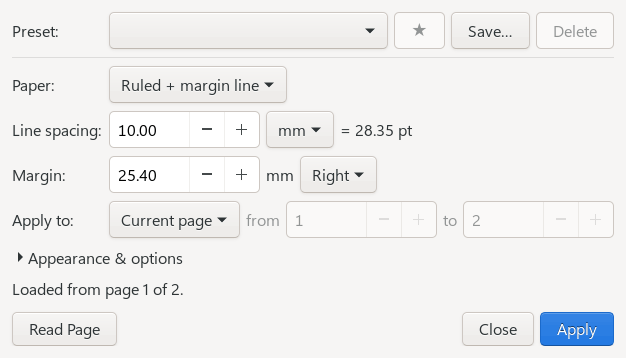

# Line Spacing

[](https://github.com/dingzy53/xournalpp-line-spacing/releases/latest)
[](https://github.com/dingzy53/xournalpp-line-spacing/releases)
[](https://xournalpp.github.io)
[](LICENSE)

Change the **line spacing (line height)**, margin line, line width and colours of Xournal++'s ruled, lined, graph and dotted page backgrounds from a settings window. Save presets for future use and start new documents with your default preset.

Xournal++ can already draw backgrounds with any spacing, but its own menus only offer the fixed 24 pt ruling. This plugin exposes the hidden per-page background settings (`r1`, `m1`, `lw`, `f1`, `f2`).



## Features

- Any line spacing, margin, line width and colours for ruled, graph and dotted paper.
- Apply to the current page, all pages or a page range.
- Named presets with a persisted unit (`pt`, `mm`, `in`) and new documents starting from the default preset.
- Saved in the `.xopp` file, so documents look the same on machines without the plugin.

## Requirements

- Xournal++ **1.3.7 or newer**. The plugin relies on the `config` argument of `app.changeCurrentPageBackground`.
- For the settings window you need GTK bindings for Lua:
  - Fedora: `sudo dnf install lua-lgi`
  - Debian/Ubuntu: `sudo apt install lua-lgi`
  - Flathub Xournal++: already bundled (LuaGObject)
  - macOS: Xournal++ 1.3.8 ships broken LuaGObject library paths, so the plugin uses the fallback dialog until Xournal++ fixes its bundle.

  Without working GTK bindings, the plugin falls back to a simpler dialog with buttons.

## Installation

1. Install the [requirements](#requirements) for your system.
2. Download `LineSpacing.zip` from the [latest release](https://github.com/dingzy53/xournalpp-line-spacing/releases/latest) and unzip it. You get a folder named `LineSpacing`.
3. Move that folder into the Xournal++ plugins folder, so that you have `plugins/LineSpacing/plugin.ini`. Create the `plugins` folder if it doesn't exist.

   | System | Plugins folder |
   |---|---|
   | Linux, macOS | `~/.config/xournalpp/plugins/` |
   | Linux, Flatpak | `~/.var/app/com.github.xournalpp.xournalpp/config/xournalpp/plugins/` |
   | Windows | `%LOCALAPPDATA%\xournalpp\plugins\` |

4. Restart Xournal++. The plugin is on by default. If its entries are missing from the **Plugin** menu, enable **LineSpacing** in **Plugin → Plugin Manager** and restart again.

**Update or remove:** replace the `LineSpacing` folder with the new one, or delete it.

**From a clone (Linux, macOS):** the install script links or copies the plugin folder for you, and finds the Flatpak folder if needed.

```sh
scripts/install.sh            # symlinks LineSpacing/ into ~/.config/xournalpp/plugins/
scripts/install.sh --copy     # copy instead of symlink
scripts/install.sh --uninstall
```

Restart Xournal++. If the plugin doesn't appear, enable it under *Plugin → Plugin Manager*.

## Usage

Everything is in the **Plugin** menu (or add them to a toolbar via **View → Toolbars → Customize**):

| Menu entry | Toolbar ID | Shortcut | What it does |
|---|---|---|---|
| Line Spacing… | `Plugin::LINE_SPACING_CONFIGURE` | Ctrl+Alt+S | Opens the settings window |
| Line Spacing: Looser (+2 pt) | `Plugin::LINE_SPACING_LOOSER` | Ctrl+Alt+= | Increases the current page's spacing |
| Line Spacing: Tighter (−2 pt) | `Plugin::LINE_SPACING_TIGHTER` | Ctrl+Alt+− | Decreases the current page's spacing |
| Line Spacing: Apply Default Preset | `Plugin::LINE_SPACING_APPLY_DEFAULT` | | Applies the preset marked ★ |
| Line Spacing: New Document (Default Preset) | `Plugin::LINE_SPACING_NEW_DOCUMENT` | | File → New, then gives page 1 the ★ preset |

### Settings window

- **Preset**: choose a built-in or saved preset, mark one ★ as default (`Set as default preset`), save via **Save…**, or delete user presets.
- **Paper**: Ruled, Ruled + margin line, Graph (with optional border), or Dotted.
- **Line spacing** in pt, mm or in (your preferred unit is remembered).
- **Margin** position for the margin line, left or right. For graph paper this is the border width.
- **Appearance & options** (collapsible): line width, custom line/margin colours, and *Also replace PDF/image backgrounds*. Auto-expands when a page or preset uses custom width or colours.
- **Apply to**: the current page, all pages, or a page range.
- Every *Apply* creates one clean undo step per changed page (`Ctrl+Z` / `⌘Z`). Press `Esc` to close the window.

### Presets and new documents

1. **Presets**: click **Save…**, type a name (or accept the suggested name), and press Enter. Presets and your preferred unit are stored in `~/.config/xournalpp/plugin-settings/LineSpacing/presets.lua`, alongside built-ins such as *College ruled (7.1 mm)* and *Wide ruled (8.7 mm)*.
2. **New documents**: **Line Spacing: New Document (Default Preset)** runs File → New and applies the ★ preset to the blank first page. Pages you insert afterwards copy the spacing, as long as *Copy last page settings* is on in *Journal → Configure Page Template* (it is by default). If Xournal++ first asks whether to save the current document, the plugin waits for your answer and never changes the old document.

The spacing is saved inside the `.xopp` file. Documents reopen with the same lines, even on machines without this plugin.

## Privacy and security

- **Network:** none. The plugin starts no other programs.
- **Files:** presets are saved in the Xournal++ config folder (`~/.config/xournalpp/plugin-settings/LineSpacing/presets.lua` on Linux). The spacing itself is saved in the `.xopp` file.

## Limitations

- The gap above the first line (80 pt) and below the last line (60 pt) is fixed in Xournal++ and cannot be changed by plugins.
- *All pages* makes one undo step per changed page.
- The plugin cannot set Xournal++'s default page template (there is no API for it, and custom templates crash released Xournal++ versions up to 1.3.8). Use *New Document (Default Preset)* instead.

## Development

```sh
lua tests/run.lua             # unit + menu/fallback tests (no Xournal++ needed)
lua tests/gtk_smoke.lua       # drives the real GTK window against a fake app (needs lgi + display)
scripts/selftest.sh           # runs inside a real Xournal++ with a throwaway config dir
scripts/render-check.sh       # renders tests/fixtures/spacing.xopp to PDF/PNG headlessly
lua scripts/screenshot.lua    # regenerates docs/images/hero.png
```

To use an unpacked lgi without installing it system-wide, run `dnf download lua-lgi && rpm2cpio lua-lgi*.rpm | cpio -idm`. Then set `LGI_ROOT=<dir>` for `selftest.sh`, or `LUA_PATH`/`LUA_CPATH` for the Lua scripts.

Code layout: `LineSpacing/` is the plugin folder. `config.lua`, `units.lua`, and `presets.lua` are pure Lua. `apply.lua` talks to the `app` API. `ui/` contains the GTK window (`dialog.lua`, `gtk.lua`) and the fallback dialog (`fallback.lua`). The design is described in [PLAN.md](PLAN.md).

### Releasing

1. Set `version=` in `LineSpacing/plugin.ini` and commit.
2. Tag that commit with the same version, without a `v`, and push both: `git tag 0.1.0 && git push origin main 0.1.0`.

The Release workflow runs the tests and publishes `LineSpacing.zip`.

## License

[GPL-2.0-or-later](LICENSE), the same as Xournal++. © 2026 Ding Zheng Yuan
